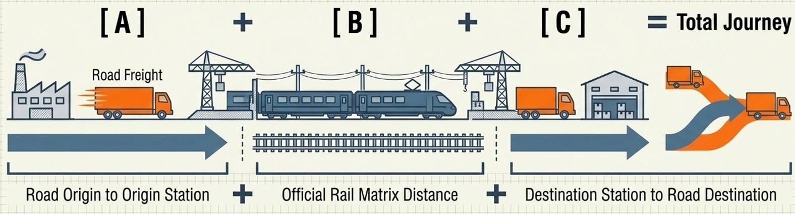
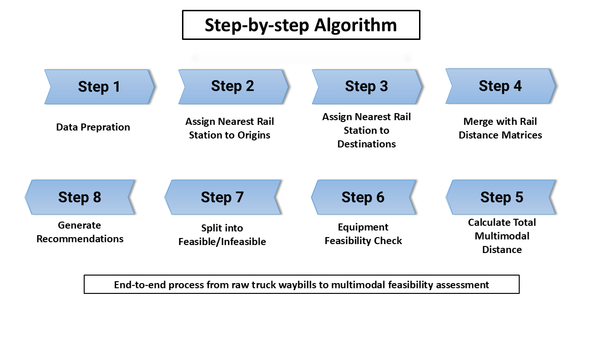
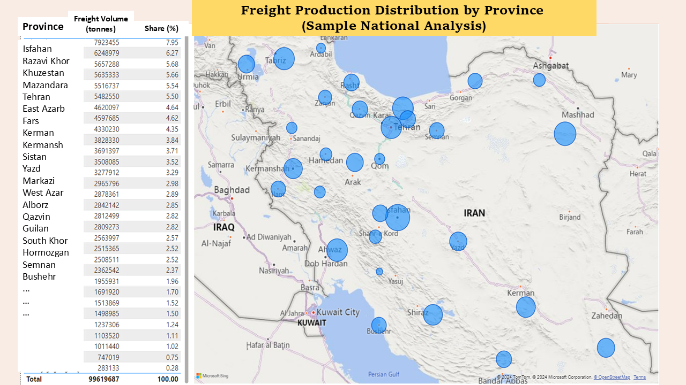

# Multimodal Road–Rail OD Pipeline

A practical data pipeline that evaluates which road freight shipments can realistically shift to rail.

It finds the nearest suitable rail station for every origin and destination (within 30 km), checks whether those stations have the required loading and unloading equipment for the specific commodity, and calculates the full multimodal distance:

**Road Origin → Origin Station + Official Rail Distance + Destination Station → Road Destination**

The final output clearly separates **Feasible** and **Infeasible** shipments.

---

## ⚠️ Code Availability
**The full pipeline code is not publicly available in this repository.**  
This repository contains only documentation, sample results, and images. The actual implementation (Python scripts, runner, etc.) is kept in a private repository.

If you need access to the code for evaluation, collaboration, or adaptation, please contact me via email:

📧 **mahditaghizade.tz@gmail.com**

I’ll be happy to discuss access on a case-by-case basis.

---

## The Core Idea



The total journey is the sum of three parts:
- **[A]** Road distance from the real origin to the nearest suitable rail station  
- **[B]** Official rail distance between the two stations  
- **[C]** Road distance from the destination station to the final delivery point  

---

## How the Pipeline Works



1. **Data Preparation** – Clean the raw truck waybill data and keep only known commodities  
2. **Assign Nearest Rail Station to Origins** (maximum 30 km)  
3. **Assign Nearest Rail Station to Destinations** (maximum 30 km)  
4. **Merge with Rail Distance Matrix**  
5. **Calculate Total Multimodal Distance**  
6. **Equipment Feasibility Check** (loading equipment at origin + unloading equipment at destination)  
7. **Split into Feasible / Infeasible**  
8. **Generate Recommendations**

---

## Sample Results



The map and table above show a sample national analysis of freight volume (in tonnes) and the share of each province.

---

## Project Structure

```text
E:\GitHub_BehtashSepahan\
├── code/                  # All pipeline scripts + run_pipeline.py
├── input/                 # Raw data files
├── output/                # Intermediate and final results
└── pics/                  # Images used in this README
```

---

## How to Run

1. Place your data files in the `input` folder.
2. Open a terminal in the `code` folder.
3. Run:

```bash
python run_pipeline.py
```

You will get a simple menu:

- **1** → Run the full pipeline  
- **2** → Run the full pipeline and open the final Excel  
- **3** → Open the last result  
- **4** → Exit  

The runner clears memory after every step and shows clear error messages if something fails.

---

## Key Features

- Handles large datasets (originally tested on ~7 GB files)
- Chunked processing + SQLite for memory efficiency
- Strict 30 km station distance filter
- Equipment compatibility check per commodity
- Clean separation of Feasible vs Infeasible shipments
- Fully automatic menu-driven execution

---

## Technologies

- Python 3
- Pandas & NumPy
- SQLite
- OpenPyXL

---

Feel free to open an issue if you want to adapt this pipeline for another country or dataset.
